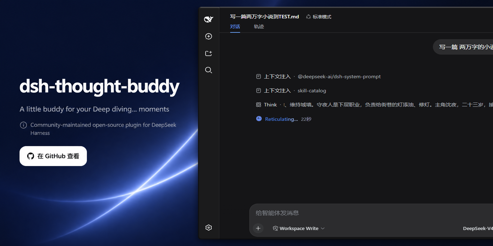
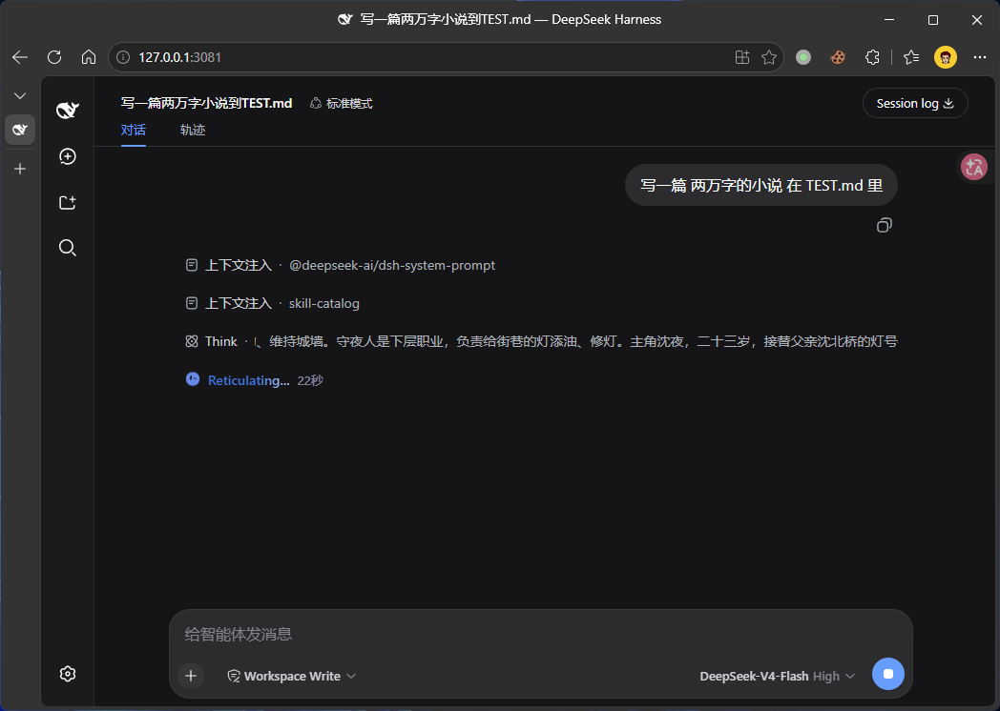

<div align="center">



# dsh-thought-buddy


**A DeepSeek Harness Web plugin that puts a dynamic little buddy — a GrokBot-style animated avatar with a synchronized typewriter status line — right in front of the "Deep diving..." indicator.**

English | [简体中文](README.zh_CN.md)

[](https://github.com/topics/dsh-plugin)
<a href="https://github.com/dsh-plugins/dsh-thought-buddy/actions/workflows/npm-publish.yml">
  
</a>
<a href="https://www.npmjs.com/package/@dsh-plugin/dsh-thought-buddy">
  
</a>
<a href="https://www.npmjs.com/package/@dsh-plugin/dsh-thought-buddy">
  
</a>

</div>

`dsh-thought-buddy` is a Web plugin with profile-backed configuration for the [DeepSeek Harness](https://deepseek-harness.github.io/deepseek-harness/) Web GUI. While the model is working, the status pill that reads `Deep diving...` grows a tiny Grok-style robot avatar: it blinks, swaps expressions with a springy morph, wanders its gaze, and gently bobs — all drawn live as **SVG via `requestAnimationFrame`**, with no additional animation library. Every time the avatar switches expression, the status text rewrites itself with a typewriter effect (deleting character by character, then typing out the next word).

The avatar animation is ported from [nasawz/GrokBot](https://github.com/nasawz/GrokBot) (a pure Flutter `CustomPaint` widget) to the web: all 25 expressions × 2 eyes × 48-point eye rings, 18 body shapes, and 39 states with their expression/blink cadences are preserved.



## Features

| Feature | Description |
| --- | --- |
| GrokBot avatar | thinking-state expression pool `[8,16,14,17,5]` cycles automatically; springy morph between expressions; 320 ms blinks (random 3.5–7 s interval); spherical head-turn projection + wandering gaze; gentle 1.7 s breathing bob |
| Expression-synced typewriter | on every expression switch, the status text leaves `Deep diving...` via a typewriter effect (delete character by character, pause, then type out the next word) cycling through 55 candidates (`Accomplishing`…`Working`), e.g. `Reticulating...` |
| Emoji mode | fallback mode that cycles an emoji list (default `🤿 🫧 🌊 🐙 🔍 🧠 💭`) with a pop-in on every switch |
| Theme aware | follows `prefers-color-scheme`: light `#5b7fe5/#fffdf7`, dark `#6689ea/#181a15` (matching the DSH theme) |
| Reduced motion | under `prefers-reduced-motion: reduce`, the bob and head-turn sway are disabled; expression changes and blinks remain |
| Self-cleaning | the animation stops as soon as the status pill leaves the DOM; inserted nodes survive React re-renders and are re-asserted on the next mutation if ever removed |

## Install

Copy the block below and paste it to your DSH agent (the assistant in this web
GUI). The agent performs the install and verification for you — no manual npm
or profile editing needed:

```text
Install the @dsh-plugin/dsh-thought-buddy plugin into the profile I specify (or ask me if I didn't name one). The npm package name is `@dsh-plugin/dsh-thought-buddy`; use the GitHub source `github:dsh-plugins/dsh-thought-buddy`, or `file:<path>` / `link:<path>` for local development.

Steps:
1. Add the plugin dependency: `dsh plugin --profile <PROFILE> add @dsh-plugin/dsh-thought-buddy` (or the equivalent plugin-manager command for my profile).
2. Verify `node_modules/@dsh-plugin/dsh-thought-buddy` resolves and holds a built `lib/` directory (at least `lib/index.js` and `lib/client.js`). Install dsh-loader 2.x alongside this plugin; building the TypeScript sources needs the `typescript` devDependency (`npm ci`/`npm install` once). If the artifacts are missing, run `npm run build` in the plugin directory and re-add.
3. Make sure the profile manifest's `dsh.profile.bundles` includes `@dsh-plugin/dsh-thought-buddy` — the bundle patch (`cordis.patch.yml`) inserts the plugin row automatically at boot.
4. Do not start the profile — install and verify only, then report what you changed.
```

Then restart `dsh web`, refresh the page, and send the model a message — the buddy appears in front of `Deep diving...`. Runtime preferences use the loader-managed configuration form and apply immediately.

### Install from a local checkout (`link:`)

For local development, wire the plugin into a web profile via a `link:` dependency (example: `C:\Users\Administrator\.dsh\profiles\web`):

```jsonc
// package.json (profile)
"dependencies": { "@dsh-plugin/dsh-thought-buddy": "link:C:/path/to/dsh-thought-buddy" },
"dsh": { "profile": { "bundles": [ /* ... */, "@dsh-plugin/dsh-thought-buddy" ] } }
```

1. Build the artifacts: `npm run build` → compiles TypeScript and produces `lib/client.js` + `lib/index.js`
2. In the profile, run `pnpm install` (works offline)
3. **Restart `dsh web`** — the client-module manifest is composed at boot, so a new bundle needs a restart
4. Refresh the page and send the model a message

## 2.0.0 configuration and migration

Requires Node.js 24.9+ and dsh-loader 2.x. Supports the loader's explicit `0.1.5`, `0.1.6`, `0.1.7`, `0.2.0`, `0.2.1` and `0.2.2` release families, including prereleases.

Loader's config-api stores preferences at `<profile>/config/dsh-thought-buddy/config.json`. Before `0.1.6-alpha.2`, open **Settings → Plugin configuration**; from that version, use the plugin detail page. The card starts collapsed. Saving immediately refreshes the animation. Reset changes the draft until saved.

| Field | Default | Meaning |
| --- | --- | --- |
| `enabled` | `true` | Show the buddy |
| `mode` | `avatar` | Animated `avatar` or cycling `emoji` |
| `size` | `18` | Size, 8–64 px |
| `emojis` | `🤿 🫧 🌊 🐙 🔍 🧠 💭` | Nonempty array of emoji strings |

1.x localStorage keys are no longer read or imported automatically. Re-enter old preferences in the form. Each profile has its own configuration; uninstalling retains the file. Unload cancels the subscription and animation, including configuration reads that complete later.

## Development and architecture

```sh
npm ci
npm run gen         # regenerate when upstream GrokBot data changes
npm run typecheck
npm run build
npm run verify
```

The host entry registers a config-api template. The client reads and subscribes to preferences, mounts the SVG/typewriter with `dshLoaderUi.mount`, and cleans up on update or unload.

`src/config.ts` contains browser-safe defaults and types; `src/config-template.ts` is host-only. tsdown bundles client ESM into a `__ModuleLoader__.load` factory. The client declares the `dshLoaderUi` service dependency; package metadata declares the loader client module dependency.

`test/verify.mjs` checks the built bundle's SVG, animation cadence, typewriter, live configuration changes and unload during an asynchronous read. The original geometry and animation engine are retained.

## Links

- Repository: https://github.com/dsh-plugins/dsh-thought-buddy
- npm: https://www.npmjs.com/package/@dsh-plugin/dsh-thought-buddy

## License

[BSD-3-Clause](LICENSE). The eye-ring geometry, body shapes, and state cadences derive from [nasawz/GrokBot](https://github.com/nasawz/GrokBot) (BSD-3-Clause, Copyright (c) 2026 nasawz), credited in the LICENSE file.
