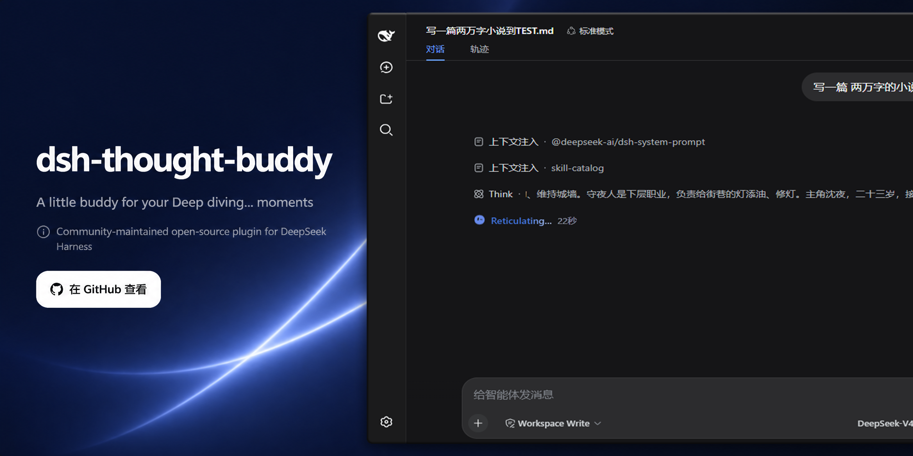
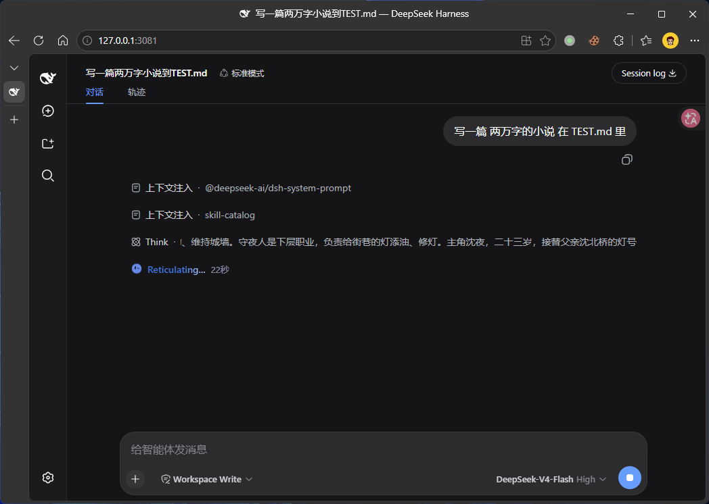

<div align="center">



# dsh-thought-buddy


**DeepSeek Harness Web 插件：在「Deep diving...」状态提示前，放一只动态小伙伴——GrokBot 风格动画头像，状态文字还会同步打字机变换。**

[English](README.md) | 简体中文

[](https://github.com/topics/dsh-plugin)
<a href="https://github.com/dsh-plugins/dsh-thought-buddy/actions/workflows/npm-publish.yml">
  
</a>
<a href="https://www.npmjs.com/package/@dsh-plugin/dsh-thought-buddy">
  
</a>
<a href="https://www.npmjs.com/package/@dsh-plugin/dsh-thought-buddy">
  
</a>

</div>

`dsh-thought-buddy` 是 [DeepSeek Harness](https://deepseek-harness.github.io/deepseek-harness/) Web GUI 插件，配置由宿主按 profile 保存。模型工作时，那行 `Deep diving...` 状态条前多了一只 Grok 风格的小机器人头像：眨眼、弹簧形变换表情、视线游移、整体轻摆——全部由 **纯 SVG + `requestAnimationFrame`** 实时绘制，动画无需额外运行库。每次头像切换表情，状态文字还会以**打字机效果**变换（先逐字符删除，再逐字打出下一个词）。

头像动画移植自 [nasawz/GrokBot](https://github.com/nasawz/GrokBot)（纯 Flutter `CustomPaint` 控件）：25 种表情 × 2 眼 × 48 点眼环、18 种身体形态、39 种状态的表情池与眨眼节奏全部保留。



## 功能

| 功能 | 说明 |
|---|---|
| GrokBot 头像 | thinking 状态表情池 `[8,16,14,17,5]` 自动轮换，弹簧形变表情过渡、320ms 眨眼（随机 3.5–7s 间隔）、球面转头投影 + 视线游移、整体轻摆（1.7s 呼吸动画） |
| 表情联动打字机 | 每次表情切换时，状态行文字从 `Deep diving...` 以打字机效果变换（先逐字符删除、停顿后逐字打出），从 55 个候选词（`Accomplishing`…`Working`）轮换，如 `Reticulating...`；React 重渲染不会覆盖（文本 fiber 的 children 字符串始终不变，React bail out） |
| Emoji 模式 | 备用模式：在 emoji 列表间轮播（默认 `🤿 🫧 🌊 🐙 🔍 🧠 💭`），每次切换带弹跳入场 |
| 主题适配 | 跟随 `prefers-color-scheme`：亮色 `#5b7fe5/#fffdf7`，暗色 `#6689ea/#181a15`（与 DSH 主题一致） |
| 减少动效 | `prefers-reduced-motion: reduce` 时关闭摆动与转头，仅保留表情/眨眼 |
| 自动清理 | 状态条消失时动画自停；插入节点在 React 重渲染下存活，万一被清掉，下一次 mutation 自动补回 |

## 安装

复制下面这段指令，粘贴给你的 DSH Agent（本 Web GUI 里的助手）。Agent 会替你完成安装与验证——无需手动操作 npm 或编辑 profile：

```text
把 @dsh-plugin/dsh-thought-buddy 插件安装到我指定的 profile（如果我没说，先问我）。npm 包名是 `@dsh-plugin/dsh-thought-buddy`；可以使用 GitHub 源 `github:dsh-plugins/dsh-thought-buddy`，本地开发用 `file:<路径>` / `link:<路径>`。

步骤：
1. 添加插件依赖：`dsh plugin --profile <PROFILE> add @dsh-plugin/dsh-thought-buddy`（或我 profile 对应的插件管理命令）。
2. 验证 `node_modules/@dsh-plugin/dsh-thought-buddy` 能解析且包含构建好的 `lib/` 目录（至少 `lib/index.js` 与 `lib/client.js`）。需要 dsh-loader 2.x；构建 TypeScript 源码需要 `typescript` devDependency（先 `npm ci` / `npm install` 一次）。若产物缺失，在插件目录运行 `npm run build` 后重新添加。
3. 确认 profile 清单的 `dsh.profile.bundles` 包含 `@dsh-plugin/dsh-thought-buddy` —— bundle patch（`cordis.patch.yml`）会在启动时自动插入插件行。
4. 不要启动 profile —— 只安装与验证，然后汇报你改了什么。
```

随后重启 `dsh web`，刷新页面后给模型发一条消息，「Deep diving...」前即出现小伙伴。运行期选项由 loader 统一配置表单管理，保存后即时生效。

### 从本地检出安装（`link:`）

本地开发时，插件以 `link:` 依赖接入 web profile（示例：`C:\Users\Administrator\.dsh\profiles\web`）：

```jsonc
// package.json（profile）
"dependencies": { "@dsh-plugin/dsh-thought-buddy": "link:C:/path/to/dsh-thought-buddy" },
"dsh": { "profile": { "bundles": [ /* ... */, "@dsh-plugin/dsh-thought-buddy" ] } }
```

1. 构建产物：`npm run build`（编译 TypeScript）生成 `lib/client.js` + `lib/index.js`
2. profile 内 `pnpm install`（离线亦可）
3. **重启 `dsh web`** —— 客户端模块清单在启动时组合，新 bundle 需要重启生效
4. 刷新页面后，给模型发一条消息

## 2.0.0 配置与迁移

需要 Node.js 24.9+ 和 dsh-loader 2.x。兼容 loader 明确支持的 `0.1.5`、`0.1.6`、`0.1.7`、`0.2.0`、`0.2.1`、`0.2.2` 系列及其预发布版。

配置由 loader 的 config-api 管理，保存到 `<profile>/config/dsh-thought-buddy/config.json`。在 `0.1.6-alpha.2` 之前打开「设置 → 插件配置」，之后在插件详情页配置。卡片默认折叠；保存后立即更新动画，无需刷新。恢复默认值只改草稿，保存后生效。

| 字段 | 默认值 | 说明 |
| --- | --- | --- |
| `enabled` | `true` | 是否显示小伙伴 |
| `mode` | `avatar` | `avatar` 动态头像或 `emoji` 表情轮播 |
| `size` | `18` | 尺寸，8–64 px |
| `emojis` | `🤿 🫧 🌊 🐙 🔍 🧠 💭` | 表情数组，至少一项 |

1.x 的浏览器 localStorage 不再读取，也不自动搬迁。请在新表单中重新设置；需要保留旧选项时手动复制。配置随当前 profile 隔离，卸载插件保留文件。插件卸载会取消配置订阅及动画；未完成的配置读取不会重新挂载。

## 开发与架构

```sh
npm ci
npm run gen         # 上游 GrokBot 数据有变化时重新生成
npm run typecheck
npm run build
npm run verify
```

宿主 `src/index.ts` 通过 `ctx.dshLoader.config.register` 注册配置模板。客户端读取并订阅配置，使用 `dshLoaderUi.mount` 挂载 SVG 动画与打字机状态，并在更新和卸载时清理。

`src/config.ts` 保存可供浏览器导入的默认值和类型；`src/config-template.ts` 是宿主专用模板，浏览器产物不导入宿主模块。tsdown 把客户端 ESM 代码打包为 `__ModuleLoader__.load` 工厂；客户端声明依赖 `dshLoaderUi` 服务，包元数据声明依赖 loader 客户端模块。

`test/verify.mjs` 验证构建产物的 SVG、动画节奏、打字机、配置即时更新以及异步读取后卸载。默认几何数据和动画引擎保留原实现。

## 链接

- 仓库：https://github.com/dsh-plugins/dsh-thought-buddy
- npm：https://www.npmjs.com/package/@dsh-plugin/dsh-thought-buddy

## License

[BSD-3-Clause](LICENSE)。眼环几何、身体形态与状态节奏数据源自 [nasawz/GrokBot](https://github.com/nasawz/GrokBot)（BSD-3-Clause, Copyright (c) 2026 nasawz），已在 LICENSE 中署名。
